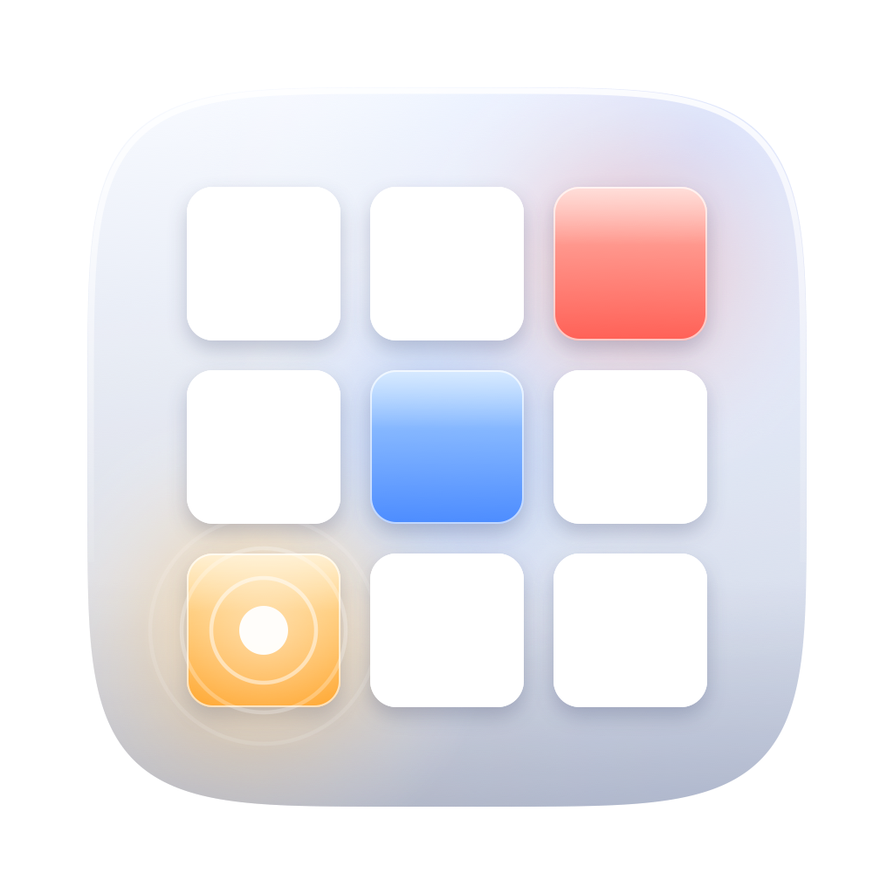

# Forchpad



Play your Mac's Force Touch trackpad as a grid of MIDI pads.

It lives in the menu bar — no Dock icon. Press a global shortcut and a small pad window
appears on top of everything: every finger is a pad, every pad is a MIDI note. Your DAW sees
a plain MIDI input called **Forchpad**. Press the shortcut again and your trackpad is
fully back.

## 01 / needs

A Force Touch trackpad — built into MacBooks from 2015 on, or a Magic Trackpad 2 or newer —
and macOS 12 or later on Apple Silicon, or macOS 13 or later on Intel. No dependencies, no
sandbox; it reads raw touches through `MultitouchSupport`, a private framework.

## 02 / build and run

```text
git clone <this repo>
cd Forchpad
./build.sh
open dist/Forchpad.app
```

That builds one universal binary from the sources in `Sources/forchpad/` and wraps it
in `dist/Forchpad.app`, ad-hoc signed for this Mac. `Package.swift` mirrors the same
sources for SwiftPM-based editing (`swift build` works on Apple Silicon; the distribution
build is `build.sh`, because Intel needs a macOS 13 target while Apple Silicon targets 12).
`./build.sh release` signs with your Developer ID and notarizes the app (set `NOTARY_PROFILE`
to your saved `notarytool` credentials name).

Recent macOS doesn't list ad-hoc signed apps in Input Monitoring at all, so the pointer
pause can't be permitted there. During development, sign with a self-signed certificate:
create it once (Keychain Access → Certificate Assistant → Create a Certificate, type
"Code Signing", then mark it trusted for code signing), and build with
`SIGN_IDENTITY="your certificate name" ./build.sh`. The stable identity also keeps the
permission across rebuilds.

Every push to **main** is built by GitHub Actions. Pushing a **tag** (e.g. `git tag v1.0
&& git push origin v1.0`) builds the app, stamps the tag as its version, and publishes a
GitHub Release titled with the tag, described by the tag's commit message, with a zipped
app attached. CI builds are ad-hoc signed, so after downloading one: right-click → Open,
or run `xattr -dr com.apple.quarantine Forchpad.app`.

The app is the letter **F** in your menu bar. Click it: **Settings…** opens the settings
window, **Quit** leaves.

## 03 / play with it

1. In Settings, pick your trackpad (the built-in one is the default), language, grid size,
   shortcut and MIDI values, then **confirm** once.
2. Press the shortcut — **⇧⌘E** unless you record your own. There is no on-screen start
   button, on purpose: starting must always work, even mid-session in your DAW.
3. The pad window appears on top. Touch the glass: bottom-left pad is the base note (36 by
   default), notes count up left to right, bottom to top. Several fingers play several pads;
   two fingers in one pad are still one note.
4. The pad window always comes up on top and can be resized but not closed — the shortcut
   is the only way out. The pin button in its top-right corner can drop it behind other
   windows mid-performance; the next start (and any pause) raises it again.
5. Press the shortcut again to stop. All sounding notes are turned off first — no stuck
   notes. A second shortcut, **⇧⌘P**, is the temporary pause: it stops the notes but leaves
   the pad window up, because clicks can't land while you play (a press would pause the
   pointer) — pausing is how you reach the pin button and the resize edges. Press ⇧⌘P again
   to resume playing; the start/stop shortcut ends the show from any state.

MIDI: a virtual source named **Forchpad**, channel 10 by default, fixed velocity 100.
Select it as an input in any DAW or MIDI monitor. The contact *size* only drives how brightly
a pad lights up; it is not pressure, and Force Touch pressure is not yet mapped to velocity.

```text
./build/Forchpad --help        the options
--external                           use an external Magic Trackpad instead of the built-in one
--rows N --cols N                    grid size, 1-10 each (default 3×3)
```

Languages: English, 简体中文, 繁體中文, 日本語, 한국어, Français, Español, العربية. The
settings window has a language menu — it defaults to **System language** (unsupported
languages fall back to English), and any choice applies immediately.

## 04 / what to know before a gig

- **The pointer pauses only while your fingers are on the trackpad.** Lift them and the
  mouse works again instantly — that's how you reach the pad window's pin button, or your
  DAW, without stopping the performance. macOS has no public way to silence one trackpad,
  so during a touch all pointing devices are paused, and one event may slip through in the
  instant a touch begins.
- **Play on the device you picked.** With an external trackpad connected, macOS can ignore
  the built-in one (System Settings → Accessibility → Pointer Control → "Ignore built-in
  trackpad when mouse or wireless trackpad is present") — then the built-in streams no
  touches at all. If the pads stay dark, open Settings and pick the trackpad your fingers
  are actually on.
- **System gestures may still fire.** Mission Control, Notification Center and friends are
  handled by the WindowServer, outside what an app can reliably block. If they get in the
  way, turn them off in System Settings → Trackpad → More Gestures before you play.
- The first time the pointer can't be paused, macOS asks for **Accessibility** permission
  (that's what gates filtering event taps); the alert's button opens the right pane. Prefer
  to keep your pointer while you play? Turn off **Pause the pointer while playing** in
  Settings — no permission is needed then, but touches will also move and click the pointer.
- MultitouchSupport is private and undocumented, so a macOS update could break touch capture.
  Everything is resolved at launch and checked, so that means a clear message, never a crash.

## 05 / how it works

```text
fingers ──▶ MultitouchSupport ──▶ pads ──▶ CoreMIDI virtual source ──▶ your DAW
            raw contact frames     edge     "Forchpad"
                                   detect
```

The touch callback only copies the contact frames out under a lock; a 125 Hz engine turns
pads down/up into Note On/Off, and the same "fingers down" flag pauses the pointer. The grid
layout is the one thing to know: normalized x left→right, y bottom→top, 96 bytes per
contact, fields verified on Apple Silicon.

**The code**, a SwiftPM-shaped layout with no dependencies:

```text
Sources/forchpad/
  main.swift                  entry point
  Core/                       settings, localization, CLI, small helpers
  Trackpad/                   MultitouchSupport loading + contact capture
  MIDI/                       the virtual source and note sending
  Engine/                     the pad grid model and the 125 Hz engine
  Input/                      the Carbon hot key and the pointer pause
  App/                        app delegate, performance state machine
  UI/                         settings window, pad window, grid view
```

## 06 / tested on

```text
tested on

MacBook Pro (Mac17,2)   M5   macOS 27.0.1   builds, runs, MIDI source appears;
                                            pad tracking needs your fingers — please report
```

Not tested yet: Intel Macs, an external Magic Trackpad, and older versions of macOS. If you
try it on another Mac, open an issue with your model, your macOS version, and whether the
pads tracked your fingers.

## 07 / license

[MIT](LICENSE)
